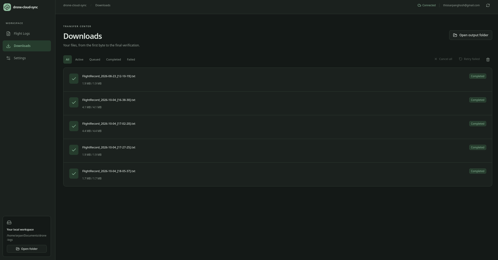
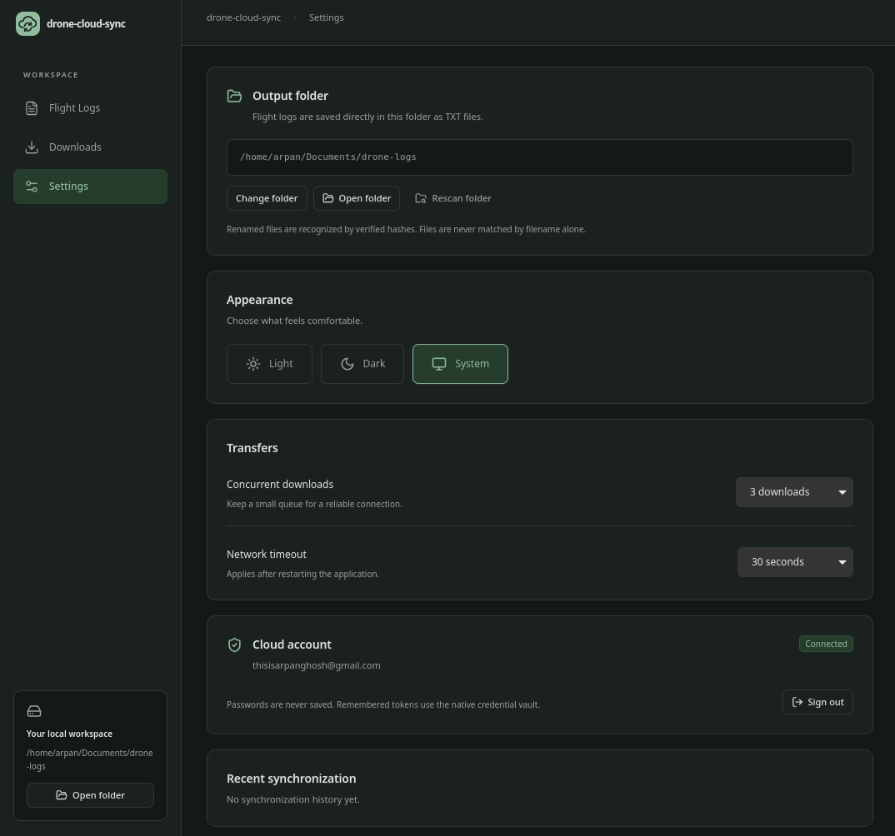

# drone-cloud-sync

<p align="center">
  <a href="https://github.com/arpanghosh8453/Drone-Cloud-Sync/releases/latest">
    
  </a>
</p>

A standalone Tauri 2 desktop application for browsing cloud flight records, downloading original flight logs, and synchronizing a local folder. Rust handles authentication, HTTP, cryptography, SQLite, extraction, hashing, and filesystem access. React handles the interface. There is no Python runtime, external application server, external database, or analytics.

This application is independently developed and is not affiliated with DJI.

## Screenshots

Browse flight records, follow synchronization progress, review downloads, and configure your account and output folder. Click a screenshot to view it at full size.

|                                                                Flight library                                                                 |                                                                  Live synchronization                                                                  |
| :-------------------------------------------------------------------------------------------------------------------------------------------: | :----------------------------------------------------------------------------------------------------------------------------------------------------: |
| [](screenshots/Screen_1.png) | [](screenshots/Syncing.png) |
|                                                            **Completed downloads**                                                            |                                                                      **Settings**                                                                      |
|            [](screenshots/Screen_2.png)             |    [](screenshots/Screen_3.png)    |

## Run locally

Install Node.js 22 or newer, Rust 1.93 or newer, and your platform's [Tauri prerequisites](https://v2.tauri.app/start/prerequisites/).

On Windows 10/11, install Microsoft C++ Build Tools with the Desktop development with C++ workload and WebView2. On Linux, install WebKitGTK 4.1, GTK 3, the DBus development libraries, and a running Secret Service credential vault. On macOS, install Xcode command line tools.

```sh
npm ci
npm run tauri dev
```

The first launch displays the account login screen. Enter your email and password, press **Connect account**, and enter the embedded CAPTCHA. CAPTCHA solving is manual. Choose a folder in Settings, then refresh or sync your flight records.

`npm run dev` alone opens the browser frontend; it deliberately does not grant cloud or filesystem access. Use the Tauri command for the working desktop application.

## Build

```sh
npm run tauri build
```

On a Windows machine this produces both an NSIS setup executable and an MSI in `src-tauri/target/release/bundle/`. The executable, installers, window title, and identifiers use `drone-cloud-sync`. The installer bootstraps WebView2 if needed. Signing is not configured; configure a signing certificate before public distribution. See [Tauri's Windows installer documentation](https://v2.tauri.app/distribute/windows-installer/).

For a native executable without installer packaging:

```sh
npm run tauri build -- --no-bundle
```

Default bundle targets follow the host platform. On Linux, select a format explicitly if needed, for example `npm run tauri build -- --bundles deb`. Runtime dependencies are the operating system webview and credential vault; Node and Rust are build dependencies only.

### macOS

Build on a Mac with Xcode command line tools. macOS 11 or newer is required. Create native application bundles and DMG installers for Apple Silicon and Intel using:

```sh
rustup target add aarch64-apple-darwin x86_64-apple-darwin
npm run tauri build -- --target aarch64-apple-darwin --bundles app,dmg
npm run tauri build -- --target x86_64-apple-darwin --bundles app,dmg
```

For each architecture, outputs appear under `src-tauri/target/<target>/release/bundle/`: the application is in `macos/` and its installer is in `dmg/`.

The [desktop workflow](.github/workflows/build.yml) checks Linux, Windows, Apple Silicon macOS, and Intel macOS. Pushes, published releases, and manual runs trigger builds. macOS jobs use the separate Rust targets and macOS runners demonstrated by the [open-dronelog build workflow](https://github.com/arpanghosh8453/open-dronelog/blob/main/.github/workflows/build.yml). Windows jobs upload NSIS/MSI installers; each macOS job uploads its DMG and an application ZIP created with `ditto` to preserve bundle metadata. Download these packages from the workflow run's **Artifacts** section.

Signing and notarization credentials are not configured. For public macOS distribution, configure an Apple signing identity and notarization credentials using [Tauri's macOS signing guide](https://v2.tauri.app/distribute/sign/macos/). Windows signing must likewise be configured before distributing a signed release.

## Sessions

Every startup loads settings and SQLite, reads the OS credential vault, and performs a small authenticated flight-list request. A stored token is never assumed valid. The interface has Checking, Connected, Disconnected, Expired, Offline, and Authenticating states.

Explicit HTTP/API authentication rejection clears the token and asks for a password and a fresh CAPTCHA. Temporary network failures and unrecognized response schemas retain the token and allow retry or cached browsing. Saved email is retained. Unknown numeric API codes are not guessed to mean expiration.

Remember session is enabled by default. The native vault stores the token and account email together, allowing correct account recovery even if SQLite is rebuilt. The password is never persisted. Unchecking Remember session removes the previous persisted session and keeps the new token only in process memory. Windows uses Credential Manager; macOS uses Keychain; Linux uses Secret Service. The app reports vault failures instead of falling back to plaintext storage.

If authentication expires during a transfer or sync, pending work pauses. Sign in with the same account to resume it; completed files remain verified. Sign out cancels active operations before clearing the session. After an application restart, interrupted attempts are marked Cancelled and can be retried or recovered through Sync. Partial network files are not resumed by byte range.

## Flight library and downloads

- Inventory pages contain 99 records by default. Supported pagination metadata takes precedence; otherwise a short or empty page ends retrieval. Each successful page is stored immediately, duplicate identities are skipped, and repeated pages, unexpected schema changes, or the 1,000-page ceiling produce an explicit partial-inventory error.
- The table searches filenames, filters by aircraft/status, sorts dates and numeric fields, and supports individual selection, all records, and all matching records. The view renders 100 rows per page while selection and filters cover the full inventory. Click a row to inspect original JSON, hashes, local paths, and download history. Numeric values retain the API's units; undocumented units are not inferred.
- Output folders are chosen with the native directory picker and remembered in SQLite. An unavailable folder produces an error; there is no silent fallback.
- Manual downloads and synchronization share one asynchronous queue. Concurrency defaults to 2 and can be changed from 1–4 when idle. Transient network and rate-limit errors receive bounded exponential retries. Transfers and queue items can be cancelled independently or together.
- Per-file events include a stable download ID, batch ID, bytes, content length when supplied, percentage, speed, ETA, and phase. Progress is throttled to eight updates per second during streaming. Unknown lengths remain indeterminate. Overall progress counts completed files in the active batches and reports transferred bytes and aggregate speed.
- Downloads are streamed to `.part` files. ZIP, gzip, and zlib payloads are extracted with a 512 MiB limit before committing `.txt` files. Raw flight logs may contain binary bytes. Unsupported archives and error documents fail; ambiguous multi-log ZIP archives require inspection. Extraction never writes archive paths to disk.
- SHA-256 and MD5 are calculated on the actual final log bytes. Temporary files and completed files use collision-safe atomic commits; unrelated files are never overwritten. Failed attempt diagnostics, byte counts, and history are retained in SQLite.

## Hash-aware synchronization

Sync validates the session, refreshes the inventory, scans the chosen folder, compares hashes, and queues only missing records. It shows the stage and the same live per-file progress as manual downloads. Cancelling preserves completed files and their database links.

Matching follows verified content MD5, a known association with a verified SHA-256, and previously indexed SHA-256 content. Renamed files, duplicate content, corruption, deletion, and changed folders are handled by rehashing actual files. Filename equality alone is ambiguous and never proves identity.

A server MD5 starts with an unknown scope. A successful download compares it against both the extracted TXT and the original payload. Only an observed TXT-content match enables cloud-to-local MD5 matching. Compressed-payload hashes are kept distinct. If a previously confirmed content hash fails, the downloaded file is not committed.

The selected folder also contains `.drone-cloud-sync-index.json`: a small, non-secret, atomically written recovery index of account-scoped record IDs, verified SHA-256 values, and observed server-hash scope. Keep it with your logs. After database reconstruction, the app imports those associations only after verifying the actual files. Without either the database or this index, previously unknown hash scope cannot safely be inferred, so candidate files remain ambiguous and may be downloaded again. Never edit or import a recovery index from an untrusted source.

The scan covers top-level TXT files in the chosen folder. Symlinks and subdirectories are not followed. It does not modify or delete existing logs. Numeric metadata alone is not used to assert file identity because the reference does not establish independent verification rules for it.

## Storage and security

SQLite resides in the Tauri application data directory as `drone-cloud-sync.sqlite`, with WAL, foreign keys, migrations, and indexed hash lookups. Schema: [`src-tauri/migrations/001_initial.sql`](src-tauri/migrations/001_initial.sql). Tables store accounts, flight metadata, local files, verified links, sync runs, attempts, and preferences. They do not store passwords or tokens.

The backend uses certificate-verified HTTPS and checks every redirect against the reference's HTTPS host allowlist before following it. Request errors never expose token-bearing URLs. CAPTCHA images remain in memory. Tauri exposes only the local commands and required event permissions; the frontend has no HTTP or filesystem plugin permissions. A restrictive CSP prevents external scripts and frames.

## Source map

- `src/`: React pages, shadcn-style Radix components, TanStack flight table, typed event state, themes.
- `src-tauri/src/auth/`: CAPTCHA lifecycle, exact protocol cryptography, vault and session state machine.
- `src-tauri/src/cloud/`: HTTP protocol, normalization, pagination.
- `src-tauri/src/downloads/`: queue, streaming progress, extraction, hashes, safe commits.
- `src-tauri/src/sync/`: inventory orchestration, local reconciliation, recovery index.
- `src-tauri/src/database/`: SQLite access and schema migrations.
- `src-tauri/src/commands.rs`: validated desktop command boundary and native folder operations.

## Implementation reference

The authentication and flight-record workflows were implemented from the supplied Python reference, with the following paper serving as an implementation reference:

Kim, H., We, D., An, W., and Park, M. (2026). [Correlation analysis of pilots and drones using DJI cloud forensic data](https://www.sciencedirect.com/science/article/abs/pii/S2666281726000582). _Forensic Science International: Digital Investigation_, 57, 302101. DOI: [10.1016/j.fsidi.2026.302101](https://doi.org/10.1016/j.fsidi.2026.302101).

## License

Copyright (c) 2026 drone-cloud-sync contributors. Licensed under the **GNU Affero General Public License, version 3 only** (`AGPL-3.0-only`). See [LICENSE](LICENSE) for the full terms.
