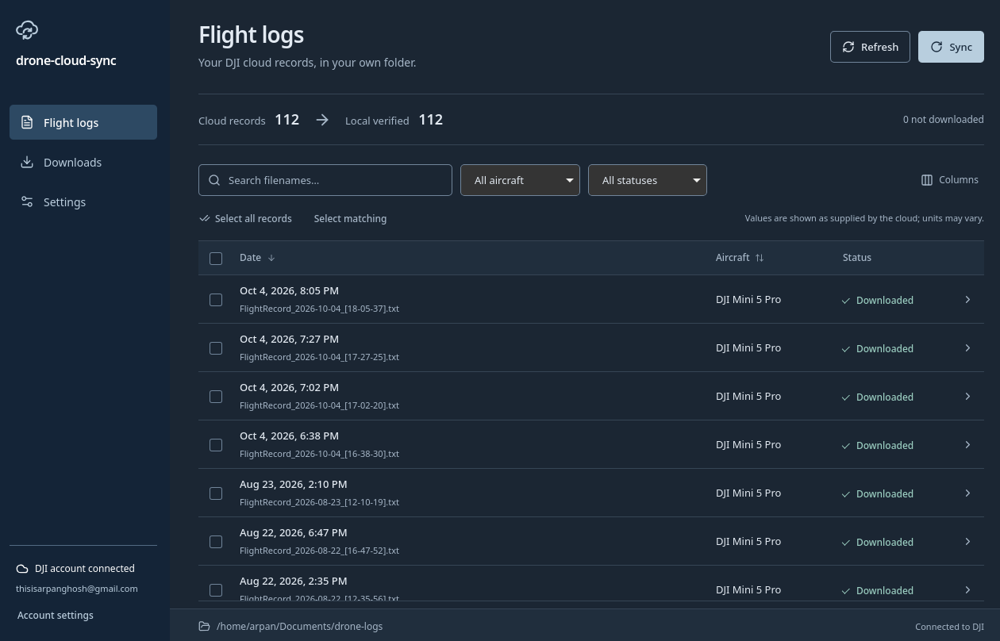
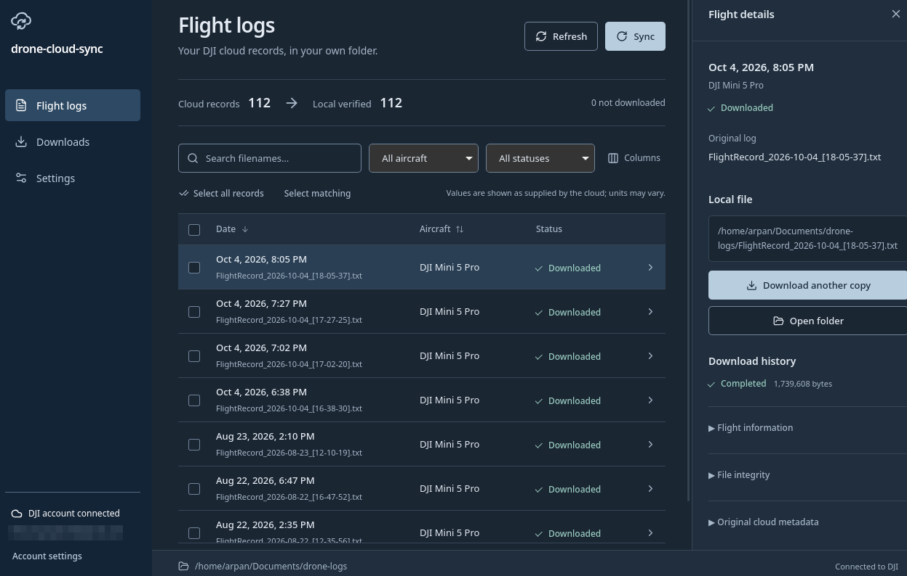

# drone-cloud-sync

<p align="center">
  <a href="https://github.com/arpanghosh8453/Drone-Cloud-Sync/releases/latest">
    
  </a>
</p>

A desktop app for browsing DJI cloud flight records, downloading original logs, and synchronizing a local folder. Built with Tauri, Rust, and React.

Independently developed; not affiliated with DJI.

## Downloads

| Platform                  | Choose this when…                                                                                   | Downloads                                             |
| ------------------------- | --------------------------------------------------------------------------------------------------- | ----------------------------------------------------- |
| Windows 10/11 (x64)       | Your PC has a 64-bit Intel or AMD processor.                                                        | [Setup EXE][windows-exe] · [MSI][windows-msi]         |
| Linux (x64)               | Choose **DEB** for Debian/Ubuntu, or **AppImage** for compatible Linux distributions.               | [AppImage][linux-appimage] · [DEB][linux-deb]         |
| macOS 11+ — Apple Silicon | Your Mac has an **Apple M-series chip** (M1, M2, M3, M4, etc.). Choose the **aarch64 / ARM64** DMG. | [Apple Silicon DMG][mac-arm-dmg] · [ZIP][mac-arm-zip] |
| macOS 11+ — Intel         | Your Mac has an **Intel processor**. Choose the **x86_64 / x64** DMG.                               | [Intel DMG][mac-intel-dmg] · [ZIP][mac-intel-zip]     |

On a Mac, open **Apple menu → About This Mac** to check the chip or processor. Open the matching DMG and drag the app into Applications; ZIPs contain the same app. On Windows, choose either EXE or MSI.

On Linux, install the DEB with your package manager, or make the AppImage executable and run it. Release packages are currently unsigned; macOS packages are not notarized.

[linux-appimage]: https://github.com/arpanghosh8453/Drone-Cloud-Sync/releases/latest/download/drone-cloud-sync-linux-x86_64.AppImage
[linux-deb]: https://github.com/arpanghosh8453/Drone-Cloud-Sync/releases/latest/download/drone-cloud-sync-linux-x86_64.deb
[windows-exe]: https://github.com/arpanghosh8453/Drone-Cloud-Sync/releases/latest/download/drone-cloud-sync-windows-x86_64-setup.exe
[windows-msi]: https://github.com/arpanghosh8453/Drone-Cloud-Sync/releases/latest/download/drone-cloud-sync-windows-x86_64.msi
[mac-arm-dmg]: https://github.com/arpanghosh8453/Drone-Cloud-Sync/releases/latest/download/drone-cloud-sync-macos-aarch64.dmg
[mac-arm-zip]: https://github.com/arpanghosh8453/Drone-Cloud-Sync/releases/latest/download/drone-cloud-sync-macos-aarch64.app.zip
[mac-intel-dmg]: https://github.com/arpanghosh8453/Drone-Cloud-Sync/releases/latest/download/drone-cloud-sync-macos-x86_64.dmg
[mac-intel-zip]: https://github.com/arpanghosh8453/Drone-Cloud-Sync/releases/latest/download/drone-cloud-sync-macos-x86_64.app.zip

## Screenshots

Click any screenshot to view it at full size.

|                                                                Flight library                                                                 |                                                                  Live synchronization                                                                  |
| :-------------------------------------------------------------------------------------------------------------------------------------------: | :----------------------------------------------------------------------------------------------------------------------------------------------------: |
| [](screenshots/Screen_1.png) | [](screenshots/Syncing.png) |
|                                                            **Completed downloads**                                                            |                                                                      **Settings**                                                                      |
|            [](screenshots/Screen_2.png)             |    [](screenshots/Screen_3.png)    |

## Getting started

Sign in with your DJI email and password, complete the CAPTCHA, and choose an output folder in **Settings**. Refresh your flight library, then download selected logs or use **Sync** to fetch missing records.

- Search, filter, and sort flights by aircraft, date, and download status.
- Follow transfer progress and speed; retry or cancel downloads.
- Sync compares file hashes to recognize existing logs, including renamed files.
- Choose light, dark, or system appearance.

## Development

Install Node.js 22+, Rust 1.93+, and the [Tauri prerequisites](https://v2.tauri.app/start/prerequisites/) for your OS. Linux also needs a running Secret Service credential vault.

```sh
npm ci
npm run tauri dev
```

Use Tauri for the desktop app; `npm run dev` starts only the browser interface. Frontend code is in `src/`; native code is in `src-tauri/`.

### Build

```sh
npm run tauri build
```

Windows produces EXE/MSI installers. On Linux, build both packages with `npm run tauri build -- --bundles appimage,deb`, or use `--no-bundle` for an executable.

For macOS, build on a Mac with Xcode command line tools:

```sh
rustup target add aarch64-apple-darwin x86_64-apple-darwin
npm run tauri build -- --target aarch64-apple-darwin --bundles app,dmg
npm run tauri build -- --target x86_64-apple-darwin --bundles app,dmg
```

Bundles appear under `src-tauri/target/release/bundle/`, or `src-tauri/target/<target>/release/bundle/` when a target is specified.

The [build workflow](.github/workflows/build.yml) publishes Linux AppImage/DEB, Windows installers, and both macOS packages to GitHub releases after all builds succeed. For a manual run, enter an existing **release_tag** to rebuild and replace its assets; leave it blank for Actions artifacts only. macOS packaging follows the [open-dronelog workflow](https://github.com/arpanghosh8453/open-dronelog/blob/main/.github/workflows/build.yml).

## Data and sessions

Remembered sessions use the OS credential vault; passwords are never saved. Flight metadata, settings, and download history use local SQLite. Expired sessions pause transfers until you sign in again. Interrupted downloads can be retried; partial files are not resumed.

Sync checks top-level TXT files without deleting existing logs. It reuses previously verified hashes when a file's size and modification time are unchanged, and reads new or changed files. Use **Rescan folder** in Settings for a full content verification, including changes that preserve both size and modification time. Keep `.drone-cloud-sync-index.json` alongside your logs to help recover file associations if the database is rebuilt.

## Implementation reference

Kim, H., We, D., An, W., and Park, M. (2026). [Correlation analysis of pilots and drones using DJI cloud forensic data](https://www.sciencedirect.com/science/article/abs/pii/S2666281726000582). _Forensic Science International: Digital Investigation_, 57, 302101. Used as an implementation reference for authentication and flight-record workflows.

## License

[GNU AGPL v3 only](LICENSE) (`AGPL-3.0-only`). Copyright (c) 2026 drone-cloud-sync contributors.
